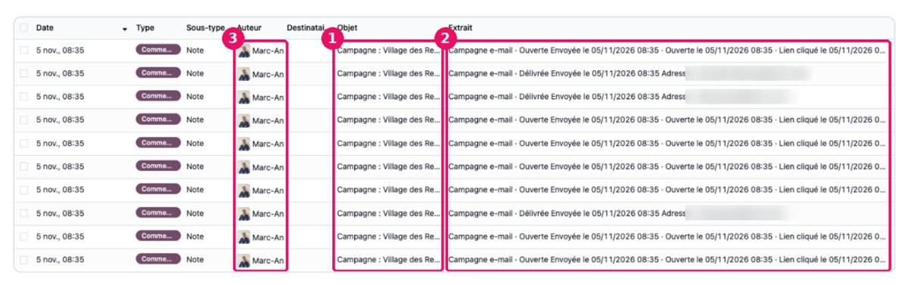

Les étapes, les trois messages de la séquence Village, les bonnes pratiques des agences, et ce qu'il faut demander. Chaque e-mail envoyé apparaît ensuite dans l'application Communications, sur la fiche du destinataire (fiche pratique B).

## Les étapes

| Étape | Qui | Ce qu'il faut faire |
|---|---|---|
| 1. Préparer | Commercial | Objectif, cible, ville, lien, signature |
| 2. Choisir le message | Commercial | Un des 3 modèles de la séquence, ou une newsletter |
| 3. Demander | Commercial | Remplir la fiche de demande et la confier à l'IA |
| 4. Préparer dans Odoo | IA | Brouillon prêt et e-mail de test dans votre boîte |
| 5. Vérifier, envoyer, suivre | Commercial | Relire, Envoyer ou Planifier, puis rappeler les plus intéressés |

Le moment d'envoi vous appartient. Vous connaissez vos contacts et votre calendrier : choisissez le jour, l'heure et l'écart entre les messages. Le guide vous donne les repères, pas un planning.

**Do It Once, Do It Right. L'IA prépare, un humain envoie.** Aucune campagne ne part sans qu'un commercial ait relu l'e-mail de test et cliqué lui-même sur *Envoyer*.

**Attention.** Pour apparaître dans Communications, la campagne doit viser des *Contacts* ou des *Pistes*. Une campagne envoyée à une liste de diffusion n'est pas rattachée aux fiches.

## Étape 1 — Préparer : ce qu'il faut avoir en main

Rassemblez ces éléments avant de demander la campagne. Ils sont repris tels quels dans l'e-mail : vérifiez-les.

| Élément | Ce qu'il faut fournir | Exemple |
|---|---|---|
| Objectif | Une seule action attendue du lecteur | Obtenir un rendez-vous de 10 minutes |
| Cible | Contacts ou Pistes, et lesquels : étiquette, ville, secteur, statut (prospect, ancien exposant…) | Recruteurs de la région nantaise jamais exposants |
| Message | Modèle 1, 2 ou 3, ou newsletter (étape 2) | Modèle 1 : premier contact |
| Ville et dates | Les variables du modèle : ville, dates, lieu, nombre de candidats, lien | Nantes · le jeudi 18 mars 2027 · Exponantes · lien de la page de l'événement |
| Signature | Prénom, nom, fonction, téléphone : les réponses arrivent chez vous | Prénom Nom, relations entreprises |
| Moment d'envoi | À votre choix | — |
| E-mail de test | Votre adresse, pour relire avant l'envoi | prenom@job.events |

Vérifiez les chiffres (dates, lieu, nombre de candidats, tarifs) et ouvrez le lien avant de transmettre la demande. Un nombre de candidats n'est cité que s'il est vérifié (fréquentation constatée d'une édition précédente) ; sinon, on ne le cite pas.

## Étape 2 — Choisir le message

Deux formats existent. Pour prospecter, préférez la lettre : un e-mail sobre, signé par vous, se lit comme un message personnel et arrive plus souvent en boîte de réception.

| Format | Pour quoi |
|---|---|
| **Lettre (séquence Village)** | Texte simple, signé par le commercial, réponse attendue par retour d'e-mail. Pour la prospection d'exposants. |
| **Newsletter (charte e-mailing VDR)** | En-tête bleu, bandeau de faits, bouton rose. Pour informer une base large : inscrits, candidats, annonces. |

### La séquence Village en 3 messages

| | 1 · Premier contact | 2 · Relance | 3 · Dernier message |
|---|---|---|---|
| Angle | Le sourcing dans les deux mondes : la vraie rencontre + la plateforme | Les coulisses : ce qui attend concrètement un exposant | Le dernier appel avant la clôture |
| Ressort | Une conviction partagée : rien ne remplace une rencontre | Le concret : stand clé en main, flux de candidats, plateforme | L'échéance réelle, et une sortie élégante |
| Appel à l'action | Répondre avec ses coordonnées | Répondre avec ses coordonnées | Dix minutes d'échange |

Envoyez le message 2 seulement aux contacts qui n'ont pas répondu au 1, et le 3 à ceux qui n'ont répondu à aucun. L'écart entre les messages est à votre appréciation : assez long pour ne pas lasser, assez court pour rester en mémoire.

| Variable | À remplacer par |
|---|---|
| {ville} | Ville de l'édition |
| {dates} | « le jeudi 18 mars » ou « les 12 et 13 octobre » |
| {lieu} | Lieu du Village |
| {candidats} | Nombre de candidats, seulement s'il est vérifié |
| {lien} | Page de l'événement sur le site : https://jobevents.odoo.com/event/… (bouton « Partager » de l'événement) |

## Les 3 messages

### Message 1 · Le sourcing, dans les deux mondes (premier contact)

*Objet : Recruter à {ville} : rencontrez des candidats de qualité, en vrai et en ligne*

> Bonjour,
>
> Votre entreprise recrute en ce moment dans la région de {ville}. À l'heure où l'IA transforme le recrutement — des CV aux entretiens vidéo — une chose n'a pas changé : rien ne remplace une vraie rencontre pour reconnaître un bon candidat.
>
> C'est le principe du Village des Recruteurs, l'événement de sourcing organisé par Job Events {dates} à {ville} ({lieu}) : nous combinons le meilleur des deux mondes. Le présentiel — {candidats} candidats de votre bassin d'emploi attendus, que vous rencontrez en face à face sur une journée. Et le digital — notre plateforme vous met en relation avec les candidats dès 5 jours avant l'événement et prolonge vos échanges 5 jours après.
>
> Découvrez l'événement : {lien}
>
> Intéressé(e) ? Répondez simplement à cet e-mail avec vos coordonnées, et nous revenons vers vous sous 24 h :
> Nom : … — Société : … — E-mail : … — Téléphone : …
>
> Bien cordialement,
> {signature du commercial}

### Message 2 · Dans les coulisses du Village (relance)

*Objet : Ce qui vous attend au Village des Recruteurs de {ville}*

> Bonjour,
>
> Je reviens vers vous au sujet du Village des Recruteurs de {ville}, {dates} au {lieu} — avec cette fois un aperçu concret de ce qui attend un exposant.
>
> Un stand clé en main au cœur du Village, sans logistique à gérer. Un flux continu de candidats — {candidats} attendus — mobilisés pour vous par notre campagne locale (médias, réseaux, partenaires emploi). La plateforme du Village, où vos offres sont visibles et où les candidats échangent avec vous avant, pendant et après le salon : votre journée de rencontres devient deux semaines de sourcing, en présentiel comme en ligne. Et l'ambiance « bien + qu'un forum emploi ! » qui fait notre signature — conviviale, directe, efficace.
>
> Le détail de l'événement : {lien}
>
> Intéressé(e) ? Répondez à cet e-mail avec vos coordonnées, et nous revenons vers vous sous 24 h :
> Nom : … — Société : … — E-mail : … — Téléphone : …
>
> Bien cordialement,
> {signature du commercial}

### Message 3 · Dernier message (clôture)

*Objet : {ville}, {dates} : dernier appel avant la clôture*

> Bonjour,
>
> C'est le dernier message que je vous envoie à ce sujet — les emplacements du Village des Recruteurs de {ville} ({dates}, {lieu}) se réservent maintenant, et je ne voulais pas que votre entreprise passe à côté : {candidats} candidats de votre région, une journée de rencontres réelles, et notre plateforme pour prolonger les échanges en ligne.
>
> Si le sujet mérite ne serait-ce qu'un échange de dix minutes, il suffit de me répondre avec vos coordonnées — et sinon, je vous souhaite sincèrement de bons recrutements :
> Nom : … — Société : … — E-mail : … — Téléphone : …
>
> Merci de votre attention,
> {signature du commercial}

Sans chiffre vérifié, retirer simplement {candidats} de la phrase (« les candidats de votre bassin d'emploi »).

### Le format newsletter

Il suit la charte e-mailing VDR : carte blanche de 600 px, en-tête bleu avec bandeau or, bandeau de faits, encadré rose pour le message clé, un seul bouton rose, pied avec désinscription. Couleurs : bleu principal et bleu foncé ; rose pour le bouton principal ; teal pour une action secondaire ; or pour le bandeau et les accents.

## Bonnes pratiques : les conseils des grandes agences

Ces principes sont ceux qu'appliquent les agences de marketing direct et de communication B2B. Ils valent pour la lettre comme pour la newsletter.

| Principe | En pratique |
|---|---|
| Une campagne, un objectif | Un seul message clé et une seule action demandée. Tout ce qui ne sert pas l'objectif sort de l'e-mail. |
| Parler du destinataire | Partir de son enjeu (recruter dans sa région, trouver des profils) avant de parler de l'événement. « Vous » plus souvent que « nous ». |
| Segmenter avant d'écrire | Un message pour les prospects, un autre pour les anciens exposants, un autre par secteur. Mieux vaut trois petites campagnes justes qu'une grosse générique. |
| Soigner l'objet et la phrase d'aperçu | Court, concret, lisible sur mobile : le lieu, la date ou le bénéfice en premier. Pas de majuscules, pas de « !!! », pas de promesse vague. |
| L'essentiel en haut | Le lecteur décide en quelques secondes, souvent sur son téléphone. Les deux premières lignes doivent suffire à comprendre l'intérêt. |
| Des preuves, pas des adjectifs | Chiffres vérifiés (candidats, entreprises présentes), noms d'exposants connus, une phrase de client satisfait. Plus crédible que « exceptionnel ». |
| Une urgence vraie | Une date de clôture, un nombre de stands limité : seulement si c'est exact. Une fausse urgence se repère et abîme la marque. |
| Un expéditeur humain | Un prénom et un nom, avec la marque. On répond à une personne, on supprime une marque. |
| Tester avant de généraliser | Comparer deux objets sur une partie de la cible (test A/B d'Odoo), puis envoyer le meilleur au reste. |
| Relancer au téléphone | Un clic ou une ouverture répétée est un signal : appeler dans les 48 h transforme bien plus qu'un nouvel e-mail. |
| Respecter la base | Lien de désinscription visible, contacts B2B pertinents uniquement (RGPD), adresses en erreur corrigées. Une base propre arrive en boîte de réception. |
| Mesurer ce qui compte | Les réponses et rendez-vous obtenus, plus que les ouvertures (faussées par certaines messageries). Notez ce qui a marché pour la prochaine campagne. |

## Étape 3 — Demander : la fiche de demande

Copiez cette fiche dans un message à l'IA (Claude) et remplissez chaque ligne. Une ligne vide = une question en retour.

```
DEMANDE DE CAMPAGNE E-MAIL — Job Events
Nom interne    : VDR (ville) - message (1/2/3)
Responsable    : (votre prénom)
Format         : Lettre, modèle 1 / 2 / 3   ou   Newsletter
Cible          : Contacts / Pistes — (filtre : étiquette, ville, secteur…)
Exclure        : (ex. ceux qui ont déjà répondu, exposants déjà inscrits)
Ville          :
Dates          :
Lieu           :
Candidats      : (seulement si vérifié)
Lien           : https://
Signature      : (prénom nom, fonction, téléphone)
Objet          : (facultatif : sinon celui du modèle)
Adaptation     : (facultatif : une phrase à personnaliser, un secteur…)
E-mail de test : (votre adresse)
Pour une newsletter, ajouter : accroche, faits clés, message clé, bouton (texte + lien).
```

La phrase à donner à l'IA :

```
Prépare dans Odoo Job Events la campagne e-mail décrite dans cette fiche,
avec le script creer_campagne.py. Crée-la en brouillon, donne-moi le nombre
de destinataires et envoie-moi un e-mail de test. Ne l'envoie pas.
```

Ce que l'IA vous renvoie : le nombre de destinataires, le lien vers le brouillon dans Odoo, l'e-mail de test dans votre boîte, et les points de la fiche qu'elle a dû compléter ou corriger.

## Étapes 4 et 5 — Vérifier, envoyer, suivre

1. Ouvrez l'e-mail de test : relisez le texte, les chiffres et les dates, cliquez sur chaque lien.
2. Ouvrez le brouillon dans *Marketing par e-mail* (ou par le lien donné par l'IA). Vérifiez l'objet et le nombre de destinataires.
3. Corrections : demandez-les à l'IA. Fermez l'onglet du brouillon pendant qu'elle travaille : un brouillon resté ouvert réécrit l'ancien contenu en s'enregistrant.
4. *Envoyer* ou *Planifier*, au moment que vous avez choisi. Si Odoo affiche un avertissement sur l'expéditeur ou le serveur de messagerie, n'envoyez pas et prévenez Marc-Antoine.
5. Suivre dans Communications, puis préparer le message suivant pour ceux qui n'ont pas répondu.

Chaque destinataire reçoit sur sa fiche une note « Campagne : <objet> », mise à jour automatiquement : Délivrée, Ouverte, Lien cliqué, Répondue, Non distribuée.



*Communications, filtre Campagnes marketing*

Après l'envoi : dans Communications, filtre *Campagnes marketing* puis recherche « Lien cliqué » : ce sont les contacts à appeler en priorité. Les « Non distribuée » signalent une adresse à corriger sur la fiche.

## Annexe pour l'IA — le script creer_campagne.py

Cette partie s'adresse à l'IA qui prépare la campagne. Le script transforme la fiche en brief JSON, construit l'e-mail (lettre à partir des 3 modèles, ou newsletter selon la charte) et crée la campagne en brouillon dans Odoo : Contacts ou Pistes, corps en fr_FR et en_US, campagne UTM. Il n'envoie jamais la campagne.

**Procédure à suivre**

1. Convertir la fiche en brief.json (modèles : `--exemple-modele 1`, `2`, `3`, ou `--exemple` pour une newsletter). Information manquante : la demander, ne pas l'inventer.
2. Traduire la cible et les exclusions en domaine Odoo ; vérifier les noms d'étiquettes dans Odoo.
3. Adapter au besoin une phrase au secteur ou à la ville, sans changer la structure ni l'appel à l'action.
4. `--preview apercu.html` et relire le rendu.
5. `--dry-run` : faire valider le nombre de destinataires.
6. Créer le brouillon avec `--test-email` (adresse du commercial).
7. Renvoyer : nombre de destinataires, lien du brouillon, corrections faites.

**Commandes**

```
export ODOO_API_KEY="..."
python3 creer_campagne.py --exemple-modele 1 > brief.json
python3 creer_campagne.py brief.json --preview apercu.html
python3 creer_campagne.py brief.json --url https://jobevents.odoo.com --db jobevents \
  --user moi@job.events --dry-run
python3 creer_campagne.py brief.json --url https://jobevents.odoo.com --db jobevents \
  --user moi@job.events --test-email moi@job.events
```

**Brief d'un message de la séquence**

```
{
  "nom_interne": "VDR {ville} - message 1",
  "objet": "",
  "campagne_utm": "VDR 2027",
  "responsable": "",
  "cible": {
    "modele": "res.partner",
    "domaine": [["category_id.name", "ilike", "VDR"]],
    "description": "à préciser"
  },
  "contenu": {
    "style": "lettre",
    "modele": 1,
    "variables": {
      "ville": "Nantes",
      "dates": "le jeudi 18 mars",
      "lieu": "Exponantes",
      "candidats": "1 700",
      "lien": "https://jobevents.odoo.com/event/le-village-des-recruteurs-de-nantes-2027-5/register"
    },
    "signature": "Prénom Nom\nChargé(e) de relations entreprises · Job Events\n06 00 00 00 00"
  }
}
```

L'objet et le texte viennent du modèle choisi ; les variables sont remplacées par le script, qui refuse le brief si l'une d'elles manque.

**Attention — interdit à l'IA :** cliquer sur *Envoyer* ou *Planifier*, viser une liste de diffusion, inventer un chiffre, un tarif ou un lien.

Une question ? Contactez Marc-Antoine.
