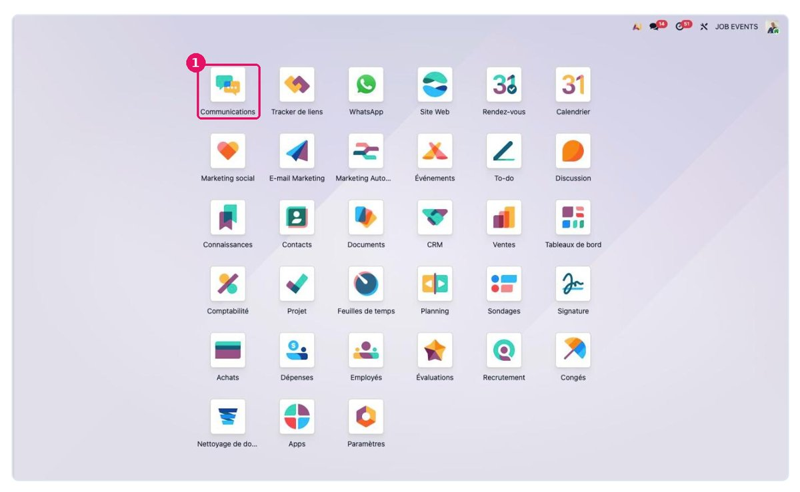
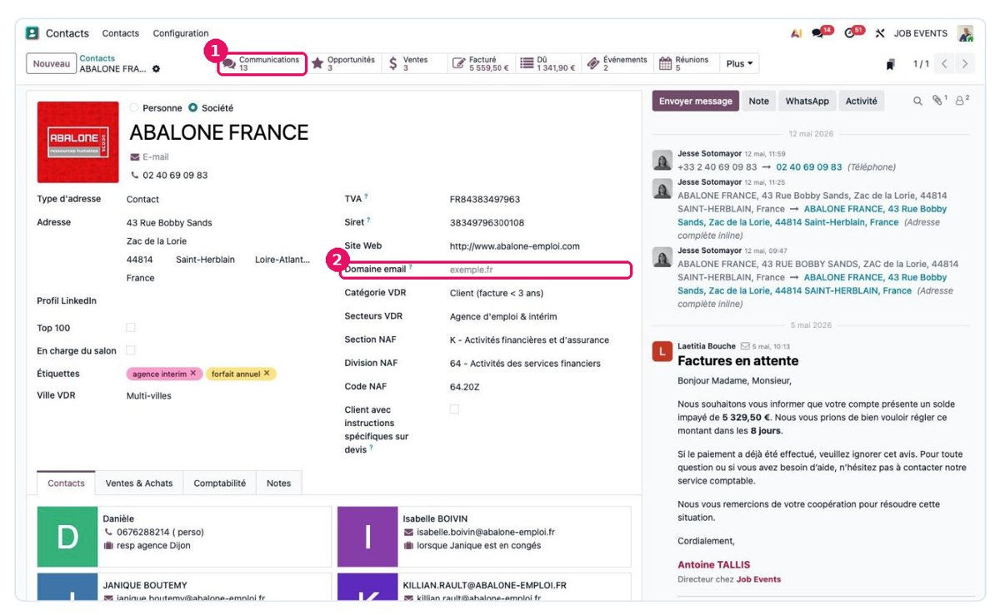
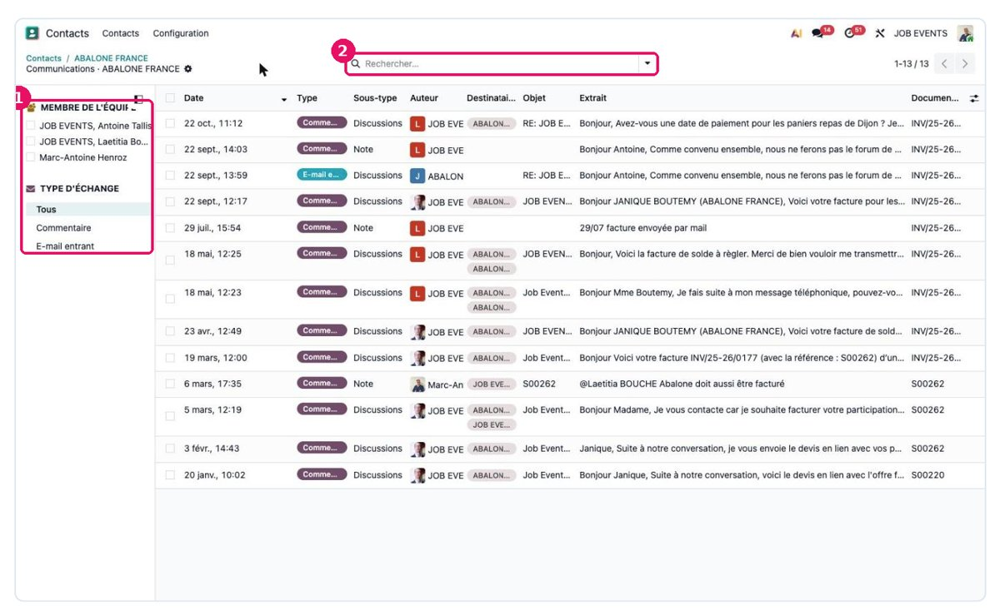
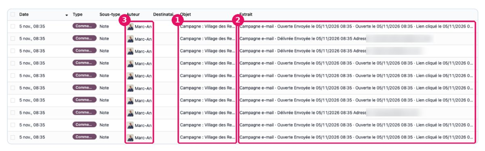
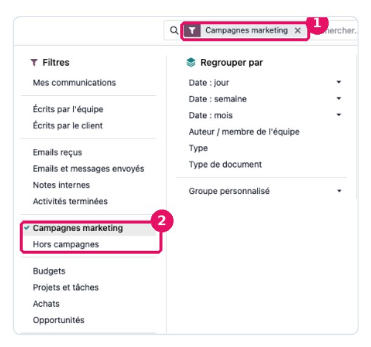
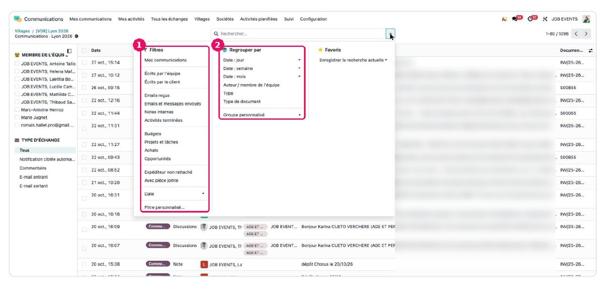
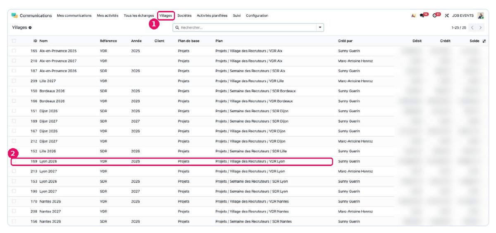
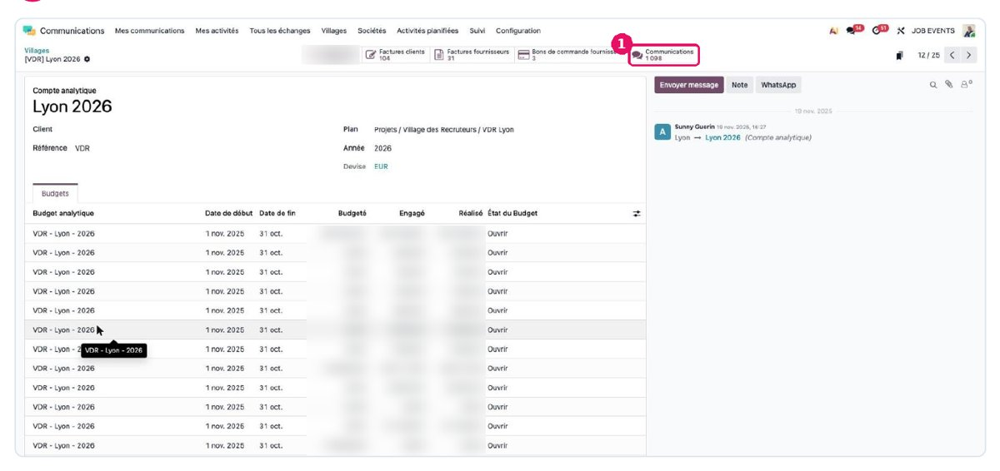
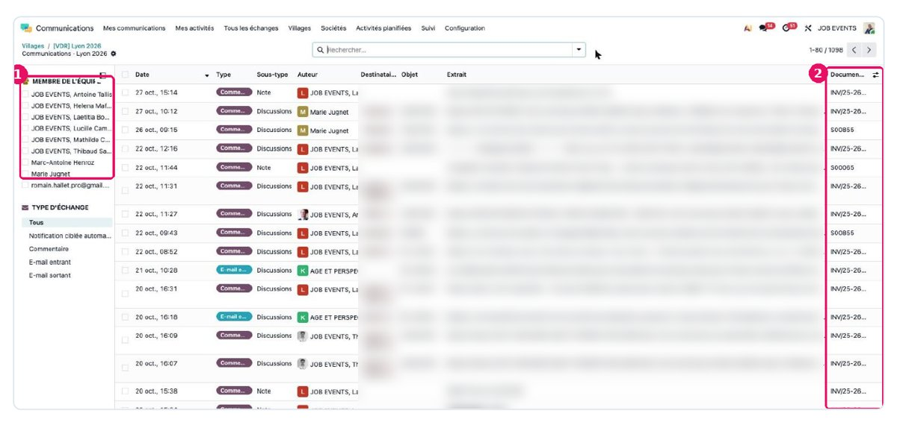
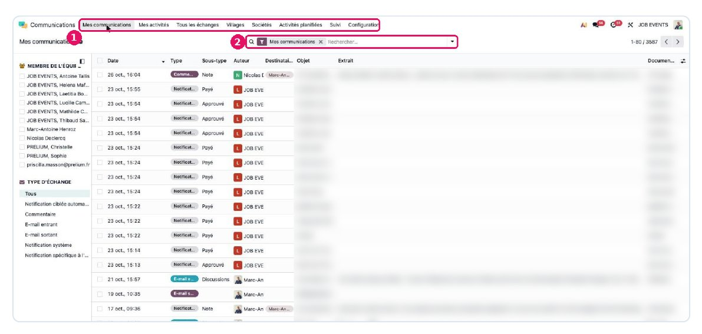

L'application Communications rassemble les e-mails reçus et envoyés, les messages, les notes internes, les activités terminées et les campagnes e-mail d'une société et de toutes les personnes qui lui sont rattachées.

## Étape 1 — Trouver l'application

Sur l'écran d'accueil d'Odoo, cliquez sur l'icône *Communications* (deux bulles de discussion). Si vous ne la voyez pas, rechargez Odoo avec la touche F5.

*L'application Communications, en tête de l'écran d'accueil*

## Étape 2 — Sur une fiche contact : le bouton Communications

Chaque fiche contact a un bouton *Communications*, le premier de la rangée en haut. Le chiffre indique le nombre d'échanges. Depuis la fiche d'une personne, vous voyez aussi les échanges de ses collègues de la même société.

*(1) Bouton Communications · (2) Domaine email*

1. **Bouton Communications** : un clic ouvre tous les échanges de la société, de ses contacts, et de leurs opportunités, devis et factures.
2. **Domaine email** (sur les sociétés) : saisissez le domaine des adresses, sans @, par exemple abalone-emploi.fr. Les e-mails de personnes pas encore enregistrées dans Odoo apparaîtront aussi.

## Étape 3 — Lire la liste des échanges

La liste s'affiche du plus récent au plus ancien. Les messages automatiques d'Odoo (« Facture créée », « Étape changée »…) sont masqués. Cliquez sur une ligne pour lire le message en entier ; la colonne *Document lié* indique le devis, la facture ou l'opportunité concernés.

*(1) Panneau de gauche · (2) Barre de recherche*

1. **Panneau de gauche** : cochez un ou plusieurs membres de l'équipe, ou choisissez un type d'échange (Commentaire = message envoyé depuis Odoo, E-mail entrant = e-mail reçu).
2. **Barre de recherche** : tapez un mot du message, un objet, une adresse e-mail ; la petite flèche ouvre les filtres.

Astuce : cliquez sur l'en-tête d'une colonne (Date, Auteur, Objet…) pour trier la liste.

## Étape 4 — Les campagnes e-mail

Chaque e-mail de campagne (*Marketing par e-mail*) envoyé à un contact ou à une piste apparaît automatiquement dans ses Communications, sous la forme d'une note interne mise à jour à chaque ouverture, clic ou réponse. Vous savez ainsi, sans quitter la fiche, quelles campagnes un client a reçues et ce qu'il en a fait.

*(1) Objet · (2) Extrait · (3) Auteur*

1. **Objet** : « Campagne : » suivi de l'objet de l'e-mail envoyé, par exemple « Village des Recruteurs 2027 : 5 villes et conditions Early Booking ».
2. **Extrait** : le statut de l'e-mail et ses dates (envoi, ouverture, clic sur un lien, réponse). Pour un e-mail non distribué, l'adresse utilisée est rappelée.
3. **Auteur** : le responsable de la campagne.

| Statut | Ce que cela veut dire |
|---|---|
| Envoyée · Délivrée | L'e-mail est parti et a été accepté par la messagerie du destinataire. |
| Ouverte | Le destinataire a ouvert l'e-mail ; « Lien cliqué » s'ajoute s'il a cliqué sur un lien. |
| Répondue | Le destinataire a répondu à l'e-mail. |
| Non distribuée · Échec | L'adresse ne fonctionne pas : vérifiez-la sur la fiche contact. |

*Voir ce qui provient des campagnes*

Ouvrez les filtres avec la petite flèche de la barre de recherche. Le filtre actif s'affiche dans la barre de recherche ; la croix le retire. *Campagnes marketing* n'affiche que les e-mails de campagne ; *Hors campagnes* les masque, pour ne garder que les échanges personnels.

Astuce : tapez « Lien cliqué » dans la recherche pour retrouver les contacts les plus intéressés, à relancer en priorité.

**Attention.** Seules les campagnes qui visent des *Contacts* ou des *Pistes* sont rattachées aux fiches. Une campagne envoyée à une liste de diffusion (par exemple les séquences de prospection Radar de Marketing Automation, qui visent les listes « Radar — Ville ») n'apparaît pas dans Communications.

## Étape 5 — Filtrer et regrouper

La flèche à droite de la barre de recherche ouvre le menu des filtres et des regroupements. Vous pouvez combiner plusieurs filtres.

*(1) Filtres · (2) Regrouper par*

1. **Filtres** : Mes communications, Écrits par l'équipe, Écrits par le client, E-mails reçus, E-mails et messages envoyés, Notes internes, Activités terminées, Campagnes marketing, Hors campagnes, Budgets, Projets et tâches, Achats, Opportunités, Expéditeur non rattaché, Avec pièce jointe, Date.
2. **Regrouper par** : date (jour, semaine, mois), auteur ou membre de l'équipe, type d'échange, type de document.

Exemple : sur la fiche d'un client, *Communications* puis le filtre « Mes communications » montre uniquement vos échanges avec lui.

## Étape 6 — Les communications d'un Village

Le menu *Villages* liste toutes les éditions du Village et de la Semaine des Recruteurs (une ligne par ville et par année). Ouvrez une édition, par exemple « Lyon 2026 », puis cliquez sur son bouton *Communications*.

*(1) Menu Villages · (2) Une édition : la colonne Référence indique VDR ou SDR*

*Le bouton Communications de l'édition, avec le nombre de messages (1 098 pour Lyon 2026)*

## Étape 7 — Tout ce qui concerne une édition

La liste rassemble les messages de tous les documents imputés à l'édition : devis et commandes, factures, achats, notes de frais, et les opportunités qui ont donné lieu à un devis pour ce Village.

*(1) Filtre par membre de l'équipe · (2) Document lié*

1. Filtrez par membre de l'équipe pour voir les échanges de chaque commercial sur ce Village.
2. La colonne *Document lié* indique le devis (S00…), la facture (INV/…) ou l'opportunité concernés.

Astuce : combinez avec les filtres Opportunités, Achats ou E-mails reçus, ou regroupez par Type de document, pour retrouver rapidement un échange sur ce Village.

**Attention.** Un document n'apparaît que s'il est imputé au compte analytique de l'édition (ex. « Lyon 2026 »). Pensez à renseigner la répartition analytique sur chaque devis, facture et achat.

## Étape 8 — Que contient chaque menu ?

Deux questions font la différence : de qui sont les messages, et de quelles applications.

*Les menus de l'application Communications*

| Menu | Les messages de qui ? | Sur quoi ? |
|---|---|---|
| Mes communications | Les vôtres : écrits par vous, qui vous sont adressés ou vous mentionnent | Toutes les applications, notifications qui vous sont destinées incluses |
| Mes activités | Les vôtres | Vos activités à venir (appels, rendez-vous, relances) |
| Tous les échanges | Toute l'équipe | Contacts, opportunités, devis, factures, campagnes e-mail — sans notifications |
| Villages | — | Liste des éditions VDR / SDR ; le bouton Communications montre tout ce qui leur est imputé |
| Sociétés | — | Liste des sociétés ; le bouton Communications d'une fiche montre ses échanges |
| Activités planifiées | Toute l'équipe | Les activités à venir de tout le monde |

« Mes communications » contient toutes vos communications, pas celles de toute l'équipe. Pour ne voir que vos échanges sur un Village ou une société, ouvrez son bouton Communications puis ajoutez le filtre « Mes communications ».

**Do It Once, Do It Right. Pour que rien ne manque :**

- Écrivez depuis Odoo (« Envoyer un message ») plutôt que depuis Gmail ou Outlook.
- Imputez chaque devis, facture et achat au compte analytique de l'édition.
- Rattachez chaque personne à sa société et remplissez le Domaine email des sociétés.

Une question ? Contactez Marc-Antoine.
